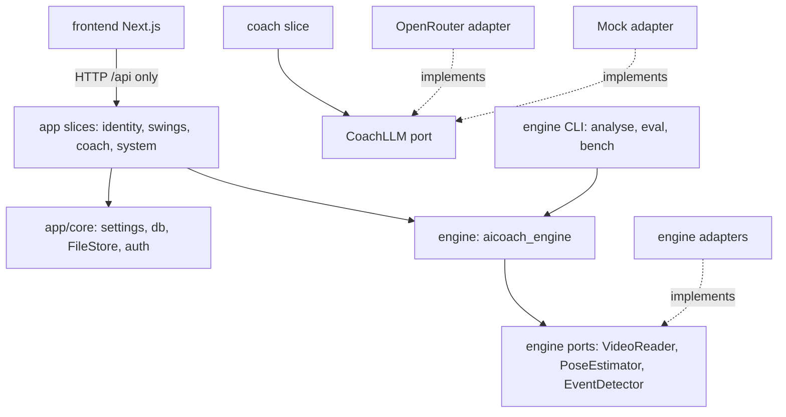
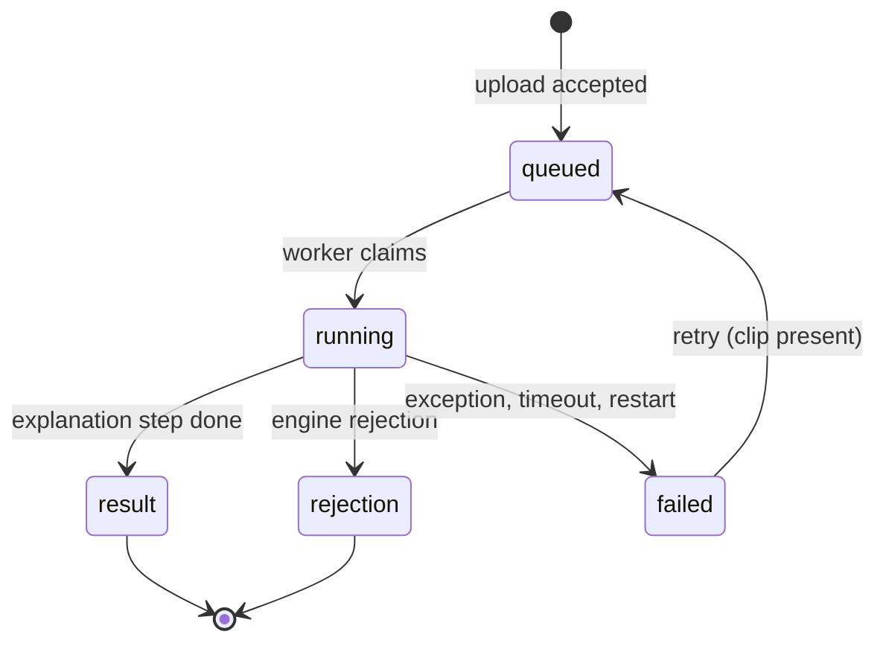
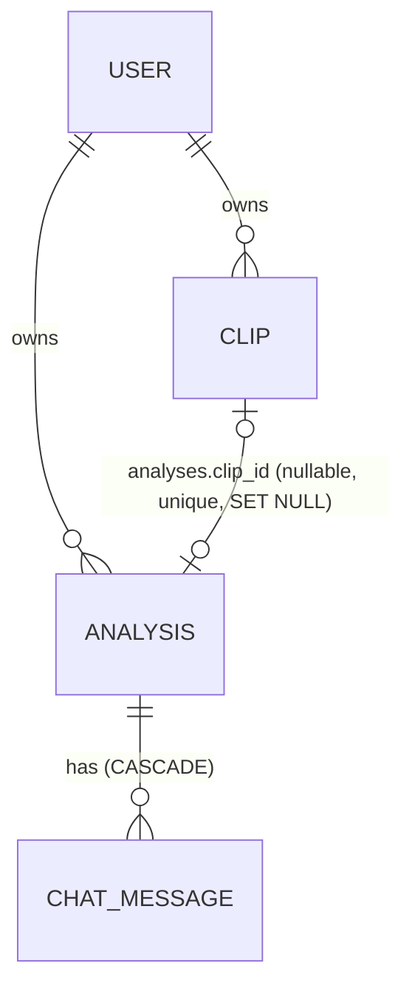
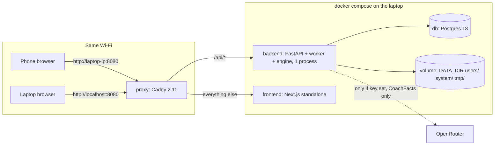
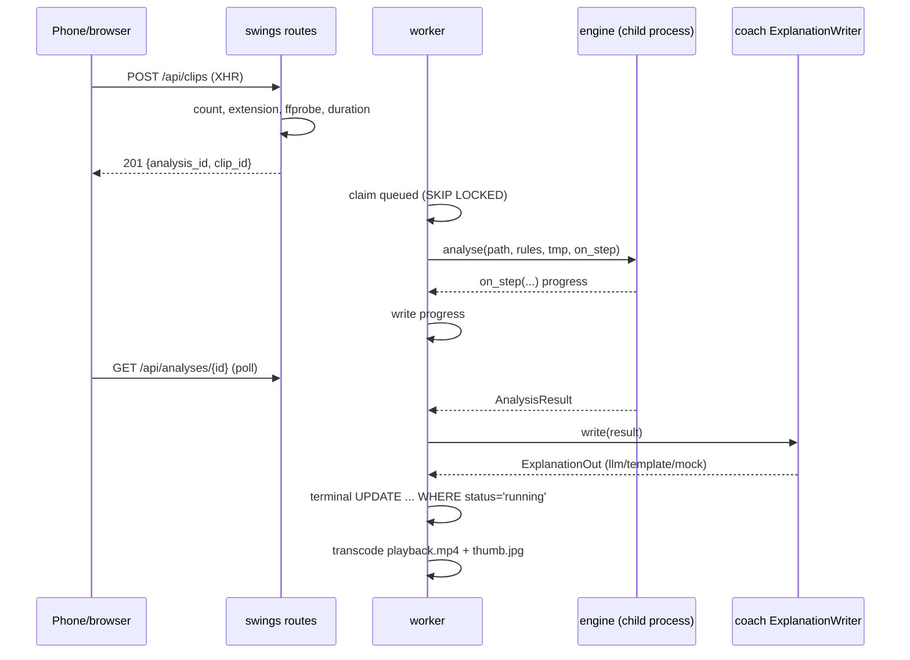

# Architecture Spine — AIcoach

## Design Paradigm

**Modular monolith** with vertical slices, adapted from the user's reference stack (`technology.md`), plus a separate **analysis engine** built as a **pipes-and-filters functional core**. The engine has ports for video reading, pose estimation and swing-event detection. The language model is reached through a port owned by the `coach` slice.

| Layer | Lives in | Holds |
| --- | --- | --- |
| Engine (pure core) | `backend/engine/aicoach_engine/` | ingest → pose → events → measurements → rules → evidence; `RuleTable` + `load_rules()`; `AnalysisResult`; `band()`; the CLI |
| Engine adapters | `backend/engine/aicoach_engine/adapters/` | VideoReader (ffprobe + OpenCV), pose backends (MediaPipe / RTMPose), event detectors |
| App slices | `backend/app/modules/{identity,swings,coach,system}/` | routes, services, repositories; the worker (`swings`); the LLM gateway, facts and grounding (`coach`) |
| Infrastructure | `backend/app/core/` | settings, DB session, FileStore, auth dependency, CSRF middleware, error envelope |
| UI | `frontend/src/modules/{identity,swings,coach,guide}/` | screens per `EXPERIENCE.md` / `DESIGN.md`; talks only to `/api` |



## Invariants & Rules

### AD-1 — The engine is a pure package

- **Binds:** FR-6–FR-13, NFR-3, all slices
- **Prevents:** analysis logic spread into routes, the DB or the worker, which would break the CLI and test-set runs.
- **Rule:**
  - `aicoach_engine` imports nothing from `app`, FastAPI, SQLAlchemy, an HTTP client or an LLM library.
  - `analyse(video_path, rules, out_dir, on_step=None) -> AnalysisResult` writes files only into `out_dir`. `on_step` reports progress (AD-5).
  - Everything runs from `aicoach-engine analyse <clip>` with no database, web app or network.
  - An `import-linter` contract, run in pytest, enforces this rule and AD-2.

### AD-2 — Slice boundaries, dependency direction and the exceptions written down

- **Binds:** all backend and frontend modules
- **Prevents:** two slices writing the same table or files, and cyclic imports.
- **Rule:**
  - Each table has exactly one owning slice:
    - `users` → `identity`
    - `clips`, `analyses` → `swings`
    - `chat_messages` → `coach`
  - Another slice reads or changes rows only through the owner's service functions.
  - `coach` may import `swings`. `swings` never imports `coach`. Instead, `coach` registers an `ExplanationWriter` with the worker at startup.
  - Only `swings` writes or deletes under `DATA_DIR/users/`.
  - Three exceptions are allowed:
    - `identity.service.lock_user(session, user_id)` is the only way to take the per-user lock.
    - `ON DELETE CASCADE` foreign keys, declared in the child table's own migration, are the only way rows are removed across slices.
    - `identity.delete_account` commits, then calls `swings.service.purge_user_files(user_id)`.
  - **Feature sub-slices and shared folders (added 2026-11-25 with the epics):** each epic is one vertical slice.
    - `swings` is split into `upload/`, `analysis/`, `library/` and `history/`, and `coach` into `explanation/` and `chat/`. Each sub-slice has its own routes and service. Sub-slices of one slice share that slice's models, `repo.py` and `repo_system.py`, so table ownership above is unchanged.
    - The frontend has one module per sub-slice (`identity`, `landing`, `guide`, `upload`, `result`, `library`, `account`, `chat`, `history`) and shared folders `src/shared/{ui,layout,api,conversation,evidence}`.
    - A slice imports only shared folders (`app/core`, the engine, `src/shared/…`) and another slice's public interface (`service.py` / `index.ts`), never its internals. `shared/` never imports a slice; `frontend/src/app/` is the only place that composes slices.
    - A component needed by a second slice moves to `shared/`. import-linter (backend) and ESLint import-boundary rules (frontend) enforce this in the test suite. Details: `../../epics.md` → Code Organisation.

### AD-3 — One origin on the local network `[ADOPTED, adapted from technology.md]`

- **Binds:** NFR-2, NFR-4, NFR-5, deployment
- **Prevents:** CORS setups, split origins that break cookie auth, and services the MVP doesn't need.
- **Rule:**
  - Caddy is the only entry point, on `0.0.0.0:8080` over plain HTTP. It routes `/api/*` to the backend and everything else to the frontend.
  - The backend serves `openapi_url=/api/openapi.json` and `docs_url=/api/docs`, with docs turned off when `APP_ENV=demo`.
  - The MVP runs only Caddy, Next.js, FastAPI with the worker inside it, and Postgres. Swing clips and pose estimation never leave the laptop.

### AD-4 — Where files live

- **Binds:** FR-18, FR-19, FR-3, §6.1
- **Prevents:** clips committed to Git, paths built from user input, the engine writing into player folders directly, and the sweep deleting system files.
- **Rule:**
  - All player files go through the `FileStore` interface, rooted at `DATA_DIR`. Paths come from IDs only:
    - `users/{user_id}/clips/{clip_id}/original.{mp4|mov}`, `playback.mp4`, `thumb.jpg`
    - `users/{user_id}/analyses/{analysis_id}/keyframes/{event}.jpg`
  - The engine writes to a scratch folder per job, `DATA_DIR/tmp/{analysis_id}/`. The worker imports the outputs through FileStore and deletes the scratch folder.
  - System files (the generated JWT secret) live in `DATA_DIR/system/`.
  - `clips.original_filename` is stored for display only. It never appears in paths, logs or `CoachFacts`.
  - Supabase Storage is a second FileStore implementation in the next phase.

### AD-5 — The analysis job

- **Binds:** FR-5, FR-6, NFR-1, UX "Analysing"
- **Prevents:** pose runs blocking HTTP requests, two jobs running at once, lost or doubled jobs, and progress reporting being invented twice.
- **Rule:**
  - **Process and claiming:**
    - The `analyses` row is the job, and the backend always runs as **one** Uvicorn process (no `--workers`).
    - One in-process worker claims jobs with a single statement: `UPDATE … SET status='running', started_at=now() WHERE id=(SELECT id … WHERE status='queued' ORDER BY created_at LIMIT 1 FOR UPDATE SKIP LOCKED) RETURNING id`.
    - It runs the engine in a one-process pool.
  - **Progress:**
    - `on_step(step_id, state, detail, partial_evidence)` is passed through a `multiprocessing` queue to the parent. The parent writes `analyses.progress = {steps: [{id, state, detail}], partial_evidence: [EvidenceItem]}`.
    - `steps` always lists all five step IDs in a fixed order. Step states are `pending | running | done | skipped | stopped`.
    - The client polls `GET /api/analyses/{id}` about once a second.
  - **Timeout:** the timeout is `ANALYSIS_TIMEOUT_SECONDS` (600), counted from `started_at`. When it passes, the worker kills the pool process, creates a new pool, and only then writes `failed`.
  - **Restart:** on startup, the orphan sweep runs first, then `running` rows are set to `failed`, then the worker starts.
  - **What counts for NFR-1:** `finished_at − started_at`, with the `explanation` step in mock mode included. Upload, queue time and the transcode are excluded. `aicoach-engine bench <clip> --runs 5` reports the median.

### AD-6 — Status machine, steps and the single terminal write

- **Binds:** FR-5, FR-8, FR-14, UX step log, UX open questions 1 and 9
- **Prevents:** a crash shown as "Cannot analyse", a result shown before its explanation exists, and two writers of `analyses.result`.
- **Rule:**



  - **Steps:** the steps are `pose → events → measurements → rules → explanation`.
  - **Rejection:**
    - The engine's ingest checks (decodability, fps, view, framing, swing count, light) run in `pose`.
    - A rejection marks its step `stopped` and later steps `skipped`. It carries `reasons: [{code, guide_step}]`.
    - A rejection gets no explanation and no fault outcomes. Its copy comes from `rules.yaml`.
  - **Explanation:**
    - `ExplanationWriter.write(result) -> ExplanationOut {explanation_text, observation_text | null, source: llm|template|mock}` never touches the database, and has its own `LLM_TIMEOUT_SECONDS` (20).
    - The worker catches **any** exception from the writer and uses the templates.
    - The `explanation` step never produces `failed`.
  - **Terminal write:** the worker alone writes the terminal state, in one statement: status, `result` (with `ExplanationOut` merged in), the final steps and `finished_at`, as `UPDATE … WHERE id=:id AND status='running'`. If that matches 0 rows, the worker deletes everything it imported for the job.
  - **Retry:**
    - Retry is allowed only when the status is `failed` and `clip_id` is not null. Otherwise it returns `409 retry_not_allowed`.
    - Retry atomically resets `status`, `progress`, `result`, `error` and the timestamps.
    - At the start of each run the worker deletes the analysis's key-frame folder.

### AD-7 — Ownership and access

- **Binds:** FR-1, FR-2, FR-3, SM-9
- **Prevents:** one endpoint forgetting the owner check, and routes without auth.
- **Rule:**
  - **Rows:** every row in `clips`, `analyses` and `chat_messages` has a `user_id`.
  - **Repository functions:**
    - In `repo.py`, every function takes `user_id` as a required argument. A row that isn't the caller's returns `404 not_found`.
    - Functions that work across all users (`claim_next_queued`, `fail_running_on_startup`, `finish_job`, `list_ids_for_sweep`) live only in `swings/repo_system.py`.
    - Only `worker.py` and the startup hook may import them, and a test asserts this.
  - **Auth on every route:**
    - Every `/api` route needs the `current_user` dependency, except `POST /api/auth/signup`, `POST /api/auth/signin`, `GET /api/config` and `GET /api/health`.
    - `current_user` loads the `users` row on every request. If the row is gone, it returns `401 session_invalid` and clears the cookie.



### AD-8 — Deletion, races and the 50-clip limit `[ADOPTED from PRD FR-3, FR-19]`

- **Binds:** FR-3, FR-5, FR-19, SM-11
- **Prevents:** files left on disk, deletes racing the worker, and different ways of counting the limit.
- **Rule:**

| Action | Database | Files (after commit) |
| --- | --- | --- |
| Delete clip, keep analysis | delete the `clips` row; `analyses.clip_id` → NULL | `original.*`, `playback.mp4`, `thumb.jpg` |
| Delete clip and analysis | delete both rows (chat cascades) | clip files + key frames |
| Delete analysis | delete the `analyses` row (chat cascades); the clip stays | key frames |
| Delete account | delete the `users` row; everything cascades | `users/{user_id}/` via `purge_user_files` |

  - Deleting a clip or an analysis while its analysis is `queued` or `running` returns `409 analysis_in_progress`, and the UI disables delete during that time.
  - Account deletion is always allowed. The worker's conditional terminal write (AD-6) cleans up after it.
  - If a file delete fails, for example because Windows has the file locked, the startup sweep retries it. The sweep walks only `users/` and `tmp/`.
  - **The limit:** the limit is the number of `clips` rows for the user. Uploads use a fast pre-check before streaming. Then, in one short transaction: `lock_user`, re-check the count, insert, move the file in.

### AD-9 — `AnalysisResult` is the one result document; `LibraryRow` is the one list row

- **Binds:** FR-7–FR-14, FR-16, FR-19, FR-20, UX result, library and account screens
- **Prevents:** the screens, the explanation and the chat each working out findings, labels, thresholds or number formats in their own way, or reading `rules.yaml` directly.
- **Rule:**
  - **What `AnalysisResult` holds:** it is defined in the engine, has a `schema_version`, and is stored as JSON in `analyses.result`. It contains:
    - `clip {fps, duration_ms, width, height, rotation}`
    - `clip_checks [{key, outcome: pass|warn|fail, display}]` and `fps_warning`
    - `events [{event, frame_index, t_ms, clarity}]`
    - `measurements [{key, label, value, unit, display, band, thresholds {potential, fault} with display}]`
    - `faults [{key, label, outcome: verified|possible|absent, band|null, deciding_measurement, chain [{role, label, likely: bool, evidence_ids}], drill, mobility}]`
    - `observation {measurement_key, template_text, text, band: low} | null`
    - `film_better [{code, guide_step}]` and `reasons [{code, guide_step, label, detail}]` (`detail` is the one-line explanation per reason, copied from `rules.yaml`; added 2026-11-26)
    - `evidence`, `explanation {text, source}`, `main_finding`, `step_timings`, `rules_hash`, `pose_backend`
  - **Rules for the contents:**
    - Labels and coaching text are copied from `rules.yaml` when the analysis runs. The frontend shows these copies and has no ID-to-label maps of its own.
    - Each measurement's `display` comes from one engine formatter. Nobody else formats numbers.
    - `main_finding` is set by the engine: the verified fault with the highest band, with ties broken by `rules.yaml` order; otherwise `no_fault` or `cannot_analyse`.
    - A stored result with an old `schema_version` returns `409 result_outdated`.
  - **`LibraryRow`:** `GET /api/clips` returns `{rows: [LibraryRow], count, limit}`, newest first.
    - `LibraryRow` = `{row_id, clip_id|null, analysis_id|null, created_at, state, main_finding_label|null, band|null, playback_state|null, thumbnail_url|null}`.
    - `state` is one of `analysing | result | rejection | failed | clip_deleted | analysis_deleted`.
    - `row_id` is the clip ID, or the analysis ID when the clip is gone.
    - The rows with no clip, `clip_deleted`, don't count toward `count`.
    - The frontend never works out `state` or the finding itself.

### AD-10 — Evidence IDs and how text cites them

- **Binds:** FR-10, FR-14, FR-20, UX pins and "Based on"
- **Prevents:** pin numbers, explanation citations and chat citations not matching.
- **Rule:**
  - The engine assigns stable IDs `E1…En`. A pin shows the number in its ID, so reordering never renumbers anything.
  - The only way to cite inside any text is `[E<n>]`. One regex in `coach/grounding.py` parses it, and `frontend/src/shared/evidence/citations.ts` mirrors it, with both tested against a shared fixture.
  - `based_on` is a structured list, never part of the text: `[{type: evidence, id} | {type: fact, key: drill|mobility|observation|rule_table|explanation}]`.

### AD-11 — The rule table is configuration with one schema and one loader `[ADOPTED from PRD FR-9, FR-13]`

- **Binds:** FR-4, FR-8–FR-14, OQ3, OQ4, OQ7
- **Prevents:** thresholds or copy hard-coded in Python, two validators for one file, and rejection links that point nowhere.
- **Rule:**
  - `config/rules.yaml` is parsed only by `aicoach_engine.load_rules(path) -> RuleTable`, a Pydantic model with `extra="forbid"` at every level. The app loads it once at startup and passes the object along, and nothing else opens the file. A file that doesn't pass stops the app.
  - It has these sections:
    - `faults`, each with `status: active | possible_only | reserve` (possible_only is the FR-9 fallback), thresholds, measurement key, cause, drill, mobility and feel cue
    - `observations` (the extra measurements and their templates)
    - `confidence` (caps, and the fps floors 30/120)
    - `coach` (the word limits 150/80, the jargon blocklist, the medical notice, refusal texts, template explanations, mock answers)
    - `guide_steps` (a fixed list of six slugs: `view`, `position`, `distance`, `frame-rate`, `framing`, `one-swing-light`; the sixth step covers both "one swing per clip" and "good light" from FR-4)
    - `reasons` (each code mapped to a `guide_step`)
  - The schema rejects an extra measurement whose key belongs to an active or possible_only fault (FR-13).
  - Swapping over the top for sway means editing the `status` fields.

### AD-12 — Outcomes come from thresholds; bands come from one function `[ADOPTED from PRD FR-7]`

- **Binds:** FR-7, FR-9, FR-13, FR-20, SM-5
- **Prevents:** a band that demotes a fault, different meanings of "deciding threshold", and bands raised outside the engine.
- **Rule:**
  - **Outcome:** a fault's outcome comes from thresholds only:
    - value past `fault` → `verified`
    - value past `potential` → `possible`
    - otherwise → `absent`
    - `possible_only` caps the outcome at `possible`.

    A band never changes an outcome.
  - **Band:**
    - `confidence.band(measurement, rule, events, visibility, fps)` is the only band function. It combines landmark visibility in the key frames, the margin to the nearest boundary of the outcome's interval, and how clearly the events were detected. It then applies the caps: under 120 fps never `high`, over the top at most `medium`.
    - A fault's band is the band of its deciding measurement.
    - `absent` faults have no band. An observation is always `low`. Where the UI lists an absent fault ("not found" in Also checked), it shows the band of its deciding **measurement**, never a fault band.
  - Code outside the engine only displays bands.

### AD-13 — Pose estimation, coordinates and joints `[ADOPTED: licence rule from PRD NFR-7]`

- **Binds:** FR-6, FR-7, FR-10, NFR-1, NFR-7
- **Prevents:** code tied to one pose library, overlays drawn 90° off, measurements that depend on the clip's aspect ratio, and visibility scales that differ between backends.
- **Rule:**
  - **The port:** `PoseEstimator` returns a `PoseSequence`: `frame_w` and `frame_h` in pixels, and per frame `{frame_index, t_ms, joints}`.
  - **Joints and coordinates:**
    - Joints use one `Joint` enum (anatomical sides): `nose, l/r_shoulder, l/r_elbow, l/r_wrist, l/r_hip, l/r_knee, l/r_ankle, l/r_heel, l/r_foot_index`. Each joint has `x/frame_w`, `y/frame_h` (origin top-left) and a visibility from 0 to 1.
    - Each adapter maps its own score onto that visibility.
    - One function maps anatomical sides to lead and trail. **In the MVP, every player is treated as right-handed**: the mapping is fixed, the engine doesn't detect handedness, and the filming guide and sign-up page say so. Left-handed support (a choice on the account that mirrors the mapping) comes in the next phase.
  - **Orientation:** the VideoReader applies the rotation metadata once, at decode. Every frame, key frame and overlay uses the upright, full, uncropped frame.
  - **Distances and angles:** they are computed only after `to_px()`, followed by the body-relative units and a 6 Hz Butterworth filter, all after the port.
  - **Adapters:**
    - Only adapters import `mediapipe` (the Tasks `PoseLandmarker`) or `rtmlib`.
    - `POSE_BACKEND` picks the adapter. Its name is recorded in `AnalysisResult`, and the confidence thresholds are re-tuned when it changes.
  - **Model files:** they are fetched when the image is built, listed in `models/MANIFEST.yaml` (URL, SHA-256, licence), and loaded from `MODELS_DIR`. They are never downloaded at runtime.
  - YOLO-pose (AGPL) is banned.

### AD-14 — Event detection is behind a port

- **Binds:** FR-6, NFR-7, SM-1
- **Prevents:** the CC BY-NC SwingNet model becoming a hidden dependency, and event frames counted from different starting points.
- **Rule:**
  - `EventDetector` returns address, top and impact, each with a `clarity`.
  - Event frames are 0-based indices into the **full** decoded stream at the clip's own frame rate, plus `t_ms`, everywhere: in the engine, in `AnalysisResult` and in `eval/labels.yaml`. Any offset from trimming is removed inside the engine.
  - The default detector is the wrist-height heuristic. SwingNet is allowed only as an optional adapter that is off by default and on the list to remove before a paid launch.

### AD-15 — Video handling and playback

- **Binds:** FR-5, FR-8, FR-19, NFR-1, SM-11
- **Prevents:** the upload route and the engine checking the same thing differently, HEVC clips that won't play, and a missing playback copy read as a deleted clip.
- **Rule:**
  - **Who checks what:**
    - The upload route checks, in this order: the library count, the extension (mp4 or mov), that `ffprobe` finds a video stream, and that the container duration is 15.0 s or less.
    - The engine checks everything else and never re-checks the extension or the duration.
  - **fps:** fps has one source, the engine's VideoReader, which records it in `AnalysisResult`. The browser shows fps only after the server has read it.
  - **Transcode:**
    - After the terminal write, the same worker slot runs the `ffmpeg` command line, which makes `playback.mp4` (H.264) and `thumb.jpg`. These belong to the clip, and the transcode is not part of NFR-1.
    - `clips.playback_state` is `pending | ready | failed`.
    - The video endpoint returns `409 playback_not_ready` or `409 playback_unavailable`, never 404, for a clip that exists.
    - If the original clip is H.264, it is served when the transcode fails.
  - `[ASSUMPTION]` fps is the stream's `avg_frame_rate`. The spike checks iPhone slow-motion and variable-frame-rate exports, and amends this AD before any upload stories start if they fail.

### AD-16 — The upload contract

- **Binds:** FR-5, FR-8, FR-18
- **Prevents:** clips stored for refused uploads, a library over 50, and holding the lock while streaming.
- **Rule:**
  - `POST /api/clips` is multipart and is the one call the frontend makes with XHR, so it can show upload progress.
  - **Limits:** `MAX_UPLOAD_MB` (300, decimal MB) is enforced by Caddy and by the backend. The frontend turns Caddy's bare 413 into `upload_too_large`.
  - **Refusals:** the AD-15 route checks return 4xx with a code, delete the temporary file, and create no row.
  - **Accepted uploads:** in the AD-8 short transaction, the backend creates the `clips` row (`playback_state=pending`) and a `queued` analysis together, then returns `{analysis_id, clip_id}`.
  - A clip the engine can't use becomes a stored `rejection`, not a 4xx.

### AD-17 — Key frames are stills; overlays are data

- **Binds:** FR-10, UX key frame and threshold ruler
- **Prevents:** overlay styling drifting from `DESIGN.md`, and coordinates that don't match the image.
- **Rule:**
  - Key frames are stored as plain JPEGs of the full upright frame. They may be scaled but are never cropped.
  - Overlay geometry (points, lines, arrows, the dashed address line) lives in `AnalysisResult`, normalised to that JPEG, and the frontend draws it as SVG with the `DESIGN.md` tokens.
  - Key-frame alt text uses the event's `t_ms`.

### AD-18 — One gateway to the language model `[ADOPTED: mock fallback from technology.md]`

- **Binds:** FR-13, FR-14, FR-15, FR-20, §6.1, §6.3, OQ2
- **Prevents:** personal data or images reaching the model, model calls spread across slices, and mock mode crashing on the provider.
- **Rule:**
  - Only `coach` calls the model, through `CoachLLM`, which has two methods:
    - `explain(facts) -> {body, feel_cues: [{fault_key, text}], observation_text|null, based_on}`
    - `answer(facts, history, question) -> {kind: answer|refusal, refusal_class: not_measured|other_swings|pain|competition|off_topic|null, text, based_on}`
  - **What the model sees:** the only input is `CoachFacts`, a projection of `AnalysisResult`, plus the player's question text exactly as typed. It never sees an email, a user ID, a clip, an image or a path.
  - **Adapters:**
    - The OpenRouter adapter (`pydantic-ai-slim[openrouter]`) is built only when `OPENROUTER_API_KEY` is set.
    - The Mock adapter builds its answers from `CoachFacts` and the `rules.yaml` mock texts, and passes the grounding check.
  - Tokens and cost are logged for every call (OQ2).

### AD-19 — One grounding check, with rules for each kind of text

- **Binds:** FR-12, FR-13, FR-14, FR-20, SM-3, SM-7, SM-13
- **Prevents:** a no-fault explanation that names a fault, checks that can't be run on free text, and the explanation and chat being checked differently.
- **Rule:**
  - **Which names a text may use:** `grounding_check(output, facts, kind)` is the only check. What it allows depends on `kind`:
    - `explanation`: only verified faults and their causes, drills and mobility exercises. It may name none when there is no fault.
    - `observation`: only the observation's measurement.
    - `chat`: any fault in `facts`, but only with its outcome word ("possible", "not found"). It never offers a drill for a possible fault or an observation.
  - **Numbers and bands:**
    - Allowed numbers are the `display` values plus the numbers inside the drill and exercise text in `facts`. Evidence IDs don't count as numbers.
    - A band word next to a fault must match that fault's band.
  - **Other checks:**
    - Word limits count `text` and `body` only.
    - No word from the jargon blocklist.
    - Exactly one `feel_cue` per verified fault.
    - Every evidence ID cited or listed in `based_on` exists.
  - **When a check fails:**
    - For the explanation and the observation, the template text is used.
    - For chat, the answer is retried once, then the fixed refusal from `rules.yaml` is stored (`source: refusal`).
    - For a `pain` question, the text is replaced by the medical notice.
  - **Templates:** every template and mock answer in `rules.yaml` is run through the check in a test, so a template can't fail at runtime.

### AD-20 — Sessions, CSRF and the library consent `[ADOPTED, adapted from technology.md]`

- **Binds:** FR-1, FR-2, FR-18, §6.1
- **Prevents:** media requests that can't carry auth, accounts created without the consent, consent text that drifts from what was stored, and sign-in failing because of email case.
- **Rule:**
  - **Session:**
    - The session is an HS256 JWT in an `httpOnly`, `SameSite=Lax` cookie that lasts 30 days. It is marked `Secure` only over HTTPS.
    - If `JWT_SECRET` is empty, the app generates one and keeps it in `DATA_DIR/system/`. A known default value is refused.
  - **CSRF:** one middleware requires `X-Requested-With: aicoach` on every `/api` request that isn't GET or HEAD, auth requests included. The fetch client and the upload XHR both set it.
  - **Email and password:**
    - Emails are trimmed and lowercased before they are stored or compared, with a unique index on that value.
    - Passwords must be 8–72 UTF-8 bytes; otherwise the server returns `422 password_invalid` before bcrypt runs.
  - **Consent:**
    - `/api/config` returns `consent {version, text}`. The sign-up form shows that text and posts `consent: true` and `consent_version`.
    - The server refuses a missing or outdated version, and stores the version and the time on `users`.

### AD-21 — OpenAPI is the API contract

- **Binds:** all endpoints, frontend data layer
- **Prevents:** frontend types drifting from the backend, `unknown` types where JSON is stored, and each endpoint using its own error shape.
- **Rule:**
  - **Typed responses:** response models reference the engine's Pydantic models directly. `dict` and `Any` are not allowed in response models.
  - **Generated types:**
    - `uv run python -m app.export_openapi` writes the committed file `frontend/openapi.json`.
    - `npm run gen:api` generates `src/shared/api/schema.d.ts` from it.
    - Hand-written domain types fail lint, and a test catches a stale `openapi.json`.
  - **Errors:** errors are always `{"error": {"code", "message"}}`, with codes from one list in `app/core/errors.py`. 422 uses the same envelope.
  - **Media:** media is served from authenticated `/api` endpoints that support Range requests (needed by iOS).

### AD-22 — The frontend is only a UI

- **Binds:** all frontend modules, NFR-5, NFR-6
- **Prevents:** a second backend growing inside Next.js, UI that drifts from `DESIGN.md`, and links that go nowhere.
- **Rule:**
  - **Data:**
    - Next.js has no database access, and no server actions or route handlers for data. All data comes from `/api` through TanStack Query.
    - A 401 sends the browser to `/signin?next=…`.
  - **Components and copy:** the UI primitives are `shadcn@4.23.0`, with the component base chosen explicitly at init. They are restyled only through Tailwind v4 `@theme` tokens copied from `DESIGN.md`. All copy is in English.
  - **Routes:** the routes are fixed:
    - Public: `/`, `/signin`, `/signup`, `/guide`, `/guide/[slug]`
    - Signed in: `/swing/new`, `/swing/[analysisId]`, `/library`, `/library/[clipId]`, `/account`
    - Signed in, P3 behind `FEATURE_HISTORY`: `/history`, `/history/compare`
  - **Guide steps:** their element IDs are the `guide_steps` slugs from `/api/config`, and a test checks that they match.

### AD-23 — Runtime config, feature flags and mock mode `[ADOPTED: FEATURE_* and mock fallback from technology.md]`

- **Binds:** FR-5, FR-15, FR-16, FR-20, §8.1 cut rules, UX mock label
- **Prevents:** limits kept in two places, a chat cut that needs a rebuild, the three kinds of chat "off" being mixed up, and P1 depending on a P3 flag.
- **Rule:**
  - **Where values live:**
    - Settings hold the app limits (15 s, mp4/mov, 300 MB, 50 clips, `slow_analysis_s=180`), `FEATURE_CHAT`, `FEATURE_HISTORY` and the `LLM_*` options.
    - `rules.yaml` holds the engine and coach limits (AD-11).
    - `GET /api/config` returns both, plus `mock_mode`, `chat_enabled`, `consent` and `guide_steps`. There are no `NEXT_PUBLIC_` flags.
  - **The three ways chat can be off:**
    - **Cut:** `FEATURE_CHAT=false`. The UI hides chat by reading the config, and the endpoints return `404 feature_disabled`.
    - **Wrong status:** chat on anything other than a `result` returns `409 chat_not_available`.
    - **Model down:** a transport error or timeout returns `503 llm_unavailable`. The UI disables the composer with the UX line, and nothing is stored.
  - **History flag:** `GET /api/analyses` (the Account list) is **P1**. `FEATURE_HISTORY` gates only the P3 history and compare UI and `GET /api/analyses/compare`.
  - **Mock mode:**
    - The app is in mock mode when `LLM_MODE=mock` or the key is empty. It never fails because a key is missing.
    - The per-result label comes from `explanation.source`. `mock_mode` drives only the global label.

### AD-24 — Keeping the tuning and evaluation sets apart

- **Binds:** FR-6, FR-9, NFR-3, SM-1–SM-6
- **Prevents:** thresholds tuned on the evaluation set, labels that don't match the engine's frames, and tuning in a different environment from the demo.
- **Rule:**
  - `eval/labels.yaml` is committed. For each clip it holds `{clip_file, split: tuning|evaluation, faults, events {address, top, impact: frame_index}}`. The frame indices follow AD-14.
  - Clips are read from `EVAL_DATA_DIR`, which is outside Git and backed up. The only exception is the bundled author samples in `samples/`.
  - Tuning and `eval` runs use the backend container (`docker compose run backend aicoach-engine eval --split …`), and the SM report records `rules_hash` and `pose_backend`.
  - Tuning tools refuse to read the `evaluation` split.

### AD-25 — Environments

- **Binds:** NFR-2, NFR-4, UJ-5
- **Prevents:** the dev app and the examiner's app drifting apart.
- **Rule:**
  - **The two ways to run:**
    - There is one Compose file, and `docker compose up` is the canonical demo and examiner run.
    - In dev, Compose runs only `db` and `proxy`. The backend runs with `uv run uvicorn --reload` and the frontend with `npm run dev` on the host, and Caddy reaches them through `BACKEND_UPSTREAM` and `FRONTEND_UPSTREAM`.
  - **Dev from a phone:** a phone on the LAN needs `allowedDevOrigins` in `next.config.ts` (from `DEV_LAN_ORIGIN`).
  - **APP_ENV:** it is `local` or `demo`.
  - **Network:** the MVP is LAN-only, with no TLS.
  - **Image builds:** images build for linux/amd64. linux/arm64 is attempted on a best-effort basis (see Deferred).

## Consistency Conventions

| Concern | Convention |
| --- | --- |
| IDs | UUIDv4, generated by the backend. Evidence IDs are `E<n>`, local to one `AnalysisResult`. |
| Time | Stored in UTC and sent as ISO 8601 with `Z`; formatted as a local date in the frontend. |
| Units | `value` + `unit` (`body_height_ratio`, `deg`, `ms`, `frames`) + `display`. The UI and the language model use only `display`. |
| Names | PRD glossary words in code: `clip`, `analysis`, `result`, `rejection`, `verified`, `possible`, `observation`, `evidence`, `key_frame`, `band`. JSON uses `snake_case`, and the TS types are generated. |
| Enums | `status`: queued/running/result/rejection/failed. `band`: high/medium/low. `outcome`: verified/possible/absent. `LibraryRow.state` per AD-9. Reason codes and guide-step slugs are defined in `rules.yaml` and exposed in OpenAPI. |
| Errors | The envelope from AD-21. Not yours → 404. A conflict with job state → 409. The model is unavailable → 503. |
| DB changes | One Alembic migration per story, rebased onto the current head. A test checks that there is exactly one head and that upgrade → downgrade → upgrade runs on Postgres. `alembic upgrade head` runs at startup. Never call `rollback()` on the shared session; use `ON CONFLICT DO NOTHING`. |
| DB types | Use `JSON().with_variant(JSONB, "postgresql")`. SQLite tests set `PRAGMA foreign_keys=ON`. Locks, cascades and worker claims are tested on Postgres (`pytest -m pg`). |
| Logging | Plain structured lines to stdout, with `analysis_id` where there is one. Never log emails, passwords, file contents or chat text. LLM tokens and cost are logged per call. |
| Secrets | `.env` is git-ignored and `.env.example` is committed. No secret ever goes in `NEXT_PUBLIC_`. |
| Tests | pytest (engine, grounding, API, an import-linter contract), Vitest (UI logic, the citation regex fixture, guide slugs), one Playwright smoke test of UJ-5 in mock mode, and `aicoach-engine eval` and `bench`. |
| Copy | UI text follows `EXPERIENCE.md` → Voice and Tone. Coaching text comes from `rules.yaml` through `AnalysisResult` or `/api/config`, never from components. |

## Stack

| Name | Version |
| --- | --- |
| Python | 3.14 |
| uv | 0.13 |
| FastAPI / Starlette / Uvicorn | 0.165 / 1.10 / 0.54 |
| SQLAlchemy `[asyncio]` + asyncpg / Alembic / aiosqlite (tests) | 2.1 + 0.32 / 1.20 / latest at lock |
| Pydantic / pydantic-settings | 2.14 / 2.16 |
| pydantic-ai-slim `[openrouter]` | 2.74 |
| PyJWT / bcrypt | 2.15 / 5.0 |
| Pose backend (the spike picks one) | mediapipe 1.2.3 (Tasks API) · rtmlib 0.0.16 + onnxruntime 1.32 |
| opencv-contrib-python-headless (the only cv2; other builds excluded with uv `exclude-dependencies`) / numpy / scipy | 5.1 / 2.5 / 1.18 |
| FFmpeg CLI | Debian package in the backend image; winget on the dev host |
| import-linter / pytest | latest at lock / 9.2 |
| Node.js | 26 LTS |
| Next.js / React | 16.4 / 19.3 |
| TypeScript | 5.x (create-next-app 16.4 pins `^5`; openapi-typescript 7 needs 5) |
| Tailwind CSS / shadcn CLI | 4.3 / 4.23.0 |
| TanStack Query / zod / openapi-typescript | 5.108 / 4.6 / 7.13 |
| Vitest / Playwright | 5.1 / 1.65 |
| PostgreSQL | 18 (image `postgres:18`; `latest` is now 19) |
| Caddy | 2.11 |
| Docker Engine + Compose | 29.x |

The lockfiles (`uv.lock`, `package-lock.json`) decide exact versions once they exist.

## Structural Seed





**Endpoints (seed; the code owns them once written):**

| Slice | Endpoints |
| --- | --- |
| identity | `POST /api/auth/signup` · `POST /api/auth/signin` · `POST /api/auth/signout` · `GET /api/me` (email, analyses_count, clips_count) · `DELETE /api/me` |
| swings | `POST /api/clips` · `GET /api/clips` (LibraryRow list + count, limit) · `GET /api/clips/{id}` · `GET /api/clips/{id}/video` · `GET /api/clips/{id}/thumb` · `DELETE /api/clips/{id}?keep_analysis=` · `GET /api/analyses` (P1 Account list) · `GET /api/analyses/{id}` · `POST /api/analyses/{id}/retry` · `DELETE /api/analyses/{id}` · `GET /api/analyses/{id}/keyframes/{event}` · `GET /api/analyses/compare` (P3) |
| coach | `GET /api/analyses/{id}/chat` · `POST /api/analyses/{id}/chat` (P2) |
| system | `GET /api/config` · `GET /api/health` |

**Source tree:**

```text
G121-naalsund/
  backend/
    engine/                       # uv workspace member: aicoach-engine (AD-1)
      aicoach_engine/
        ingest.py pose.py events.py measures.py rules.py confidence.py
        evidence.py result.py formatting.py cli.py
        adapters/                 # video_cv.py, mediapipe_pose.py, rtmpose.py, wrist_events.py
    app/
      core/                       # settings, db, files (FileStore), auth, csrf, errors
      modules/
        identity/  system/                      # routes.py service.py repo.py schemas.py
        swings/                                 # models, repo.py, repo_system.py (AD-7) shared by its sub-slices
          upload/ analysis/ library/ history/   # each: routes.py service.py schemas.py (AD-2 sub-slices)
          analysis/worker.py                    # AD-5
        coach/                                  # llm.py facts.py grounding.py shared by its sub-slices
          explanation/ chat/
      export_openapi.py
      migrations/                 # Alembic
    models/MANIFEST.yaml          # pose weights: URL, SHA-256, licence (AD-13)
    tests/
    pyproject.toml uv.lock Dockerfile
  frontend/
    openapi.json                  # committed, generated (AD-21)
    src/app/                      # routes per AD-22; the only place that composes slices
    src/modules/                  # identity, landing, guide, upload, result, library, account, chat, history
    src/shared/                   # ui, layout, conversation, evidence; api = schema.d.ts (generated), fetch client, upload XHR
    Dockerfile
  config/rules.yaml               # AD-11
  eval/labels.yaml                # AD-24
  samples/                        # bundled author clips (README, mock demo)
  Caddyfile  docker-compose.yml  .env.example  README.md
```

## Capability → Architecture Map

| Capability | Lives in | Governed by |
| --- | --- | --- |
| FR-1 Account, consent · FR-2 Privacy · FR-3 Delete | `identity`, `swings` repo | AD-2, AD-7, AD-8, AD-20 |
| FR-4 Filming guide | `frontend/modules/guide`; slugs and reasons in `rules.yaml` | AD-11, AD-22 |
| FR-5 Upload | `swings` routes + upload XHR | AD-15, AD-16, AD-23 |
| FR-6 Pose, events, measurements | `engine` | AD-1, AD-13, AD-14, AD-15 |
| FR-7 Confidence | `engine/confidence.py` | AD-12 |
| FR-8 Rejection | `engine/ingest.py` + status machine | AD-6, AD-11, AD-15 |
| FR-9–12 Faults, chain, drills, no forced fit | `engine/rules.py`, `rules.yaml` | AD-9, AD-10, AD-11, AD-12, AD-17 |
| FR-13 Unverified observation | `engine` (selection) + `coach` (rephrase) | AD-11, AD-12, AD-19 |
| FR-14 Explanation | `coach` via the worker's `explanation` step | AD-6, AD-18, AD-19 |
| FR-15 Mock mode | `coach/llm.py` Mock adapter, `/api/config` | AD-18, AD-23 |
| FR-16–17 History, compare (P3) | `swings` + `FEATURE_HISTORY` | AD-9, AD-23 |
| FR-18–19 Swing library | `swings`, FileStore | AD-4, AD-8, AD-9, AD-15 |
| FR-20 Coach chat (P2) | `coach` + `FEATURE_CHAT` | AD-10, AD-18, AD-19, AD-23 |
| NFR-1 Speed | worker + engine trimming + `bench` | AD-5, AD-15 |
| NFR-2, NFR-4 Local, examiner run | Compose, Caddy, bundled model files | AD-3, AD-13, AD-25 |
| NFR-3 Testability | engine CLI, eval harness | AD-1, AD-24 |
| NFR-5 Mobile | single origin, Range requests, responsive UI | AD-3, AD-21, AD-22 |
| NFR-6 English | UI copy, `rules.yaml` | AD-22, AD-11 |
| NFR-7 Licensing | pose and event adapters, model manifest | AD-13, AD-14 |

## Deferred

| Item | Why it can wait / when |
| --- | --- |
| Pose backend default (MediaPipe vs RTMPose) | Week-1 spike on the target laptop. AD-13 keeps both swappable. |
| Measurement definitions and thresholds (OQ3) | Tuning set. The measurement keys, `Joint` enum and units are already fixed (AD-9, AD-13). |
| Over the top vs sway (OQ4), the replacement observation (OQ7) | 2026-12-01 checkpoint on the tuning set; a `status` edit in `rules.yaml` (AD-11). |
| Language model and cost (OQ2) | P2 start. `[ASSUMPTION]` a small, cheap model through `OPENROUTER_MODEL`; cost is logged (AD-18). |
| `[ASSUMPTION]` iPhone slow-motion and variable-frame-rate fps and duration | The spike checks them. AD-15 is amended before any upload stories start if they fail. |
| linux/arm64 image (an examiner on Apple silicon) | The spike checks the mediapipe and rtmlib wheels on arm64. If they fail, the README says amd64 only, or the default is rtmlib. |
| Public hosting, TLS, Supabase, Railway, backups, monitoring, CSP | Next phase (NFR-2). Follow `technology.md` §5–§8: FileStore gets a Supabase implementation and Compose maps to Railway. |
| Rate limiting, password reset, email | LAN MVP (PRD §4.1). Add per-IP limits on auth and chat when the app goes public. |
| Data export (GDPR) | Next phase (PRD §6.1). |
| Licence review of FFmpeg/x264 (GPL, used as a separate CLI) and SwingNet | Before any paid launch (NFR-7). |
| Several analyses at once, GPU | One player on one laptop. |
| Left-handed players | Next phase: a handedness choice on the account that mirrors the lead/trail mapping in AD-13. The MVP is right-handed only. |
| Visual details | `DESIGN.md`'s open questions. |
